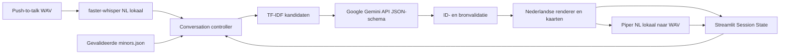

# Architectuur

## Gegevensstroom

De webapp en audioverwerking zijn lokaal; tekst, historie en geselecteerde
minorrecords worden via HTTPS aan Google Gemini verstuurd. Geen Ollama-call,
providerfallback, eigen server voor businesslogica of database.

## Modulegrenzen

| Module | Verantwoordelijkheid |
| --- | --- |
| app.py / pages / core/ui.py | Navigatie, invoer, weergave, zichtbare disclosure; geen modelbusinesslogica |
| config.py | .env laden uit repositoryroot; echte omgeving heeft voorrang; Settings verbergt key in repr |
| core/controller.py | Invoer → STT → retrieval → agent → kaarten → TTS; geen Streamlit of opslag |
| core/session.py | Caller-beheerde geschiedenis, eventdeduplicatie en reset |
| ai/search.py | TF-IDF-shortlist, standaard twaalf kandidaten, actuele tekst zwaarder dan historie |
| ai/agent.py | Nederlandse prompt, providerinjectie, parsing, bronvalidatie en vaste renderer |
| ai/providers/gemini_provider.py | Officiële google-genai Developer API, expliciete key/model/endpoint, JSON-schema, timeout, foutcodes en client sluiten |
| speech/stt.py / tts.py | Lazy lokale modellen, Nederlands, gevalideerde WAV-bytes in geheugen |
| core/diagnostics.py | Readiness zonder API-calls, feitelijke evidence en expliciete Gemini-proef |
| core/test_service.py | Vaste shell=False pytest-opdracht, achtergrondworker, timeout90, JUnit, begrensde uitvoer |
| scraper/ | Onafhankelijke ingestion/loader; productieparser nog onvoltooid |
| scripts/start.ps1 | Venv/packages/start; optionele speechpackages; geen modeldownload of overschrijven bestaande .env |

## Contracten

chat_with_agent(message, history, minors, *, provider=None) geeft
{response, recommended_minor_ids, needs_more_info}. Zonder provider wordt
Gemini uit de configuratie gebruikt. run_turn gebruikt Settings expliciet en
geeft TurnResult met kaarten, optionele WAV en zeven stappen:
STT, Controller, Retrieval, LLM, Validation, TTS, Audio output.

Het interne modelantwoord bevat action ask/recommend/refer, question_topic en
maximaal drie aanbevelingen met minor_id, student_quote en description_quote.
Het API-schema beperkt IDs tot de shortlist. Python controleert vervolgens
onafhankelijk structuur, IDs, aantallen en letterlijke bronfragmenten.
Vrije modeltekst wordt nooit als advies of TTS gebruikt. De vaste renderer
vermeldt AI, bronlinks en menselijke doorverwijzing.

De standaardmodelalias is gemini-flash-latest, overschrijfbaar met GEMINI_MODEL.
De SDK doet één poging per aanroep; geen verborgen retrylus of modelwissel bij
quota/auth/503. App-timeout60s, zelfstandige providerdefault30s. Alle fouten
worden vaste codes, zonder SDK-exceptiontekst of sleutel in de uitvoer.
GOOGLE_API_KEY blijft alleen een compatibiliteitsfallback bij zelfstandig
GeminiProvider() gebruik; de app leest expliciet GEMINI_API_KEY.

## Sessies, privacy en diagnostiek

Gesprekken, transcripties, ruwe output en audio blijven aan applicatiezijde
alleen in Session State. Geen gesprek- of audiobestanden. Gegevens die naar
Gemini gaan vallen daarnaast onder Google's API-voorwaarden. Modelcaches
bevatten alleen modellen. .env, modellen en .runtime staan buiten Git.

Audio-event-IDs en gespreksepoch voorkomen dubbele verwerking bij reruns.
Een nieuw gesprek leegt chatstatus; de diagnostiek heeft een aparte wisknop.
Een stap begint NOT_TESTED; alleen uitgevoerde geslaagde controles krijgen
PASS. Bron-, model- of outputproblemen stoppen downstream uitvoering.
Vindbare packages en modelbestanden bewijzen geen werkende generatie/spraak.
Historische scrape-informatie is geen nieuwe broncontrole.

De pytest-worker draait apart; model- en audiobeurten zijn synchroon.
Historie is begrensd tot veertig berichten van maximaal achtduizend tekens.
TF-IDF en letterlijke quotes bewijzen geen inhoudelijke relevantie.
De oude Ollama-adapter blijft alleen voor bestaande imports/tests beschikbaar.
