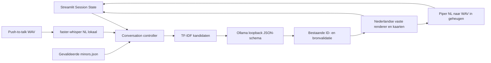

# Architectuur

## Lokale gegevensstroom

`app.py` configureert en routeert via `st.navigation`; pagina's bevatten alleen
invoer/weergave en roepen services aan. `config.py` is de centrale configuratie.
`core/ui.py` deelt status- en uitvoerweergave om duplicatie te beperken.

## Modulegrenzen

| Module | Verantwoordelijkheid |
| --- | --- |
| core/controller.py | Valideert invoer, orkestreert audio/tekst → retrieval → agent → kaarten → TTS. Geen Streamlit-import of opslag. |
| core/session.py | Nieuwe gesprekken en idempotent toevoegen van een beurt. Caller bewaart de dict in Session State. |
| ai/search.py | Kleine deterministische TF-IDF-ranking; huidige input weegt zwaarder dan oudere antwoorden. Geen semantisch bewijs. |
| ai/agent.py | Bestaande prompt, parsing, bronvalidatie en gecontroleerde renderer; injecteerbare provider en tijdelijke AgentRun-diagnostiek. |
| ai/providers/ollama_provider.py | REST /api/tags en /api/generate. Alleen HTTP-loopback, geen redirects/proxy of downloads. |
| speech/stt.py | WAV-validering, lokale Whisper-load met CPU/int8 en Nederlands. |
| speech/tts.py | Nederlandse stemconfiguratie, lokale Piper-load, WAV-bytes in geheugen. |
| core/diagnostics.py | Bestands-/omgevingchecks, werkelijke functionele evidence, historische scraperstatus en losse modelproef. |
| core/test_service.py | Vaste pytest-commandolijst in achtergrondworker, geen shell, timeout 90s, JUnit en max. 12.000 tekens output. |
| scraper/ | Onafhankelijke ingestion; bronparser blijft expliciet onvoltooid. |

## Publieke contracten

`chat_with_agent(message, history, minors, *, provider=None)` houdt
`{response, recommended_minor_ids, needs_more_info}` aan. Zonder provider blijft
de legacy Gemini-route beschikbaar voor eerdere callers. De Streamlit-controller
maakt uitsluitend Ollama aan. Er is geen automatische provider-fallback.

`run_turn(..., audio=None, speak=False)` retourneert een `TurnResult` met
gecontroleerde `result`, `cards`, optionele WAV-bytes, tijdelijke `AgentRun` en
zeven stappen: STT, Controller, Retrieval, LLM, Validation, TTS, Audio output.
Audio output PASS bewijst een geldige WAV, niet dat een gebruiker die gehoord heeft.

De lokale JSON-generatie gebruikt hetzelfde interne schema als de legacy-agent:
action ask/recommend/refer, vraagcategorie en maximaal drie aanbevelingen met
minor_id, student_quote en description_quote. De bestaande validator controleert
ID-lidmaatschap, unieke ID's en letterlijke bronfragmenten. Retrieval beperkt de
kandidaten (standaard 12); de LLM kan alleen daaruit kiezen. Nul woordoverlap is
geen bewijs van geen match; kandidaten blijven dan in bronvolgorde beschikbaar.

## Sessies en privacy

Geschiedenis, audiobytes, transcripties en ruwe uitvoer worden uitsluitend in
Streamlit Session State bewaard. Modelcaches bevatten alleen modellen, geen
studentdata. Er worden geen audio- of chatbestanden geschreven. Permanente
bestanden zijn configuratie, brondata en het scraperapport. Pytest gebruikt een
tijdelijke map onder .runtime met uitsluitend synthetische testdata.

Een input-event wordt eenmaal toegevoegd. Audio krijgt een SHA-256-event-ID,
waardoor dezelfde opname niet opnieuw wordt verwerkt bij reruns. Een nieuw gesprek
krijgt een nieuwe epoch en leegt de geschiedenis en berichten. Ruwe modeloutput
wordt alleen als expliciet ongevalideerde diagnostiek getoond, nooit uitgesproken.

## Diagnostiek en fouten

Elke stap begint NOT_TESTED. Een werkelijk uitgevoerde geslaagde stap krijgt PASS.
Een eerdere blokkade laat downstream stappen NOT_TESTED; ongeldige modeloutput
stopt vóór kaarten en TTS. Model-/packagevindbaarheid is alleen readiness,
functioneel bewijs wordt apart geregistreerd met tijd en modus. Historische
scraperstatus wordt nooit als nieuwe broncontrole gepresenteerd.

De achtergrondworker voorkomt dat pytest het UI-thread blokkeert. Normale LLM-
en audiobeurten zijn voor dit PoC synchroon; de LLM heeft een 60s-timeout.
Maximaal 40 historische berichten en 8000 tekens per bericht. Geen hosting,
asynchrone scraping, database, LangChain of vectorindex.
